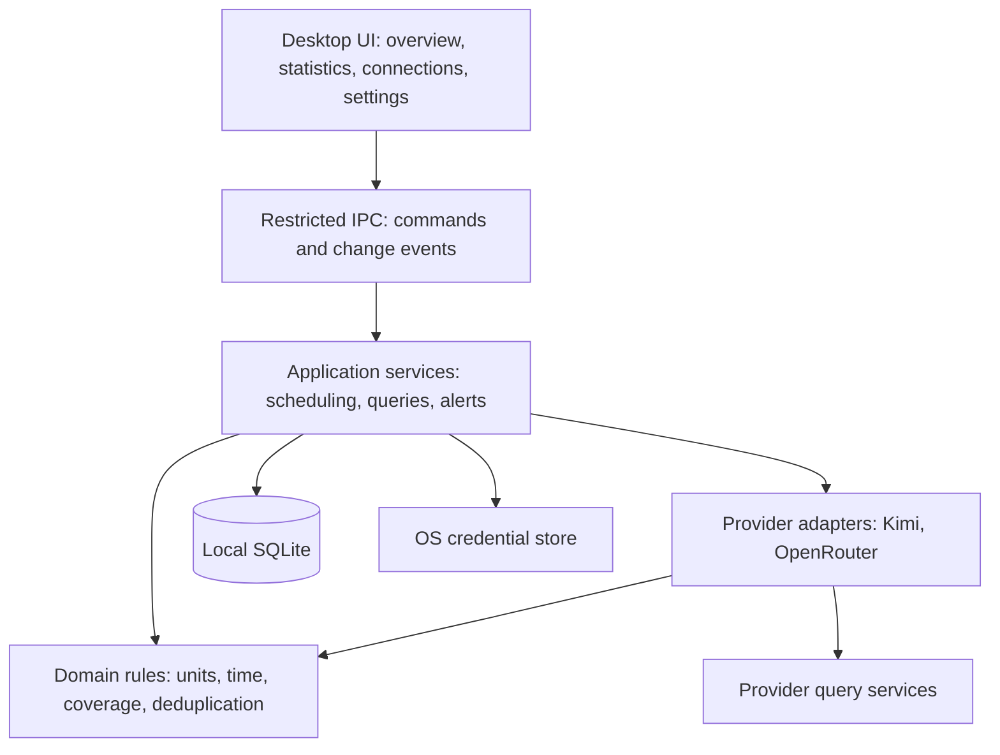
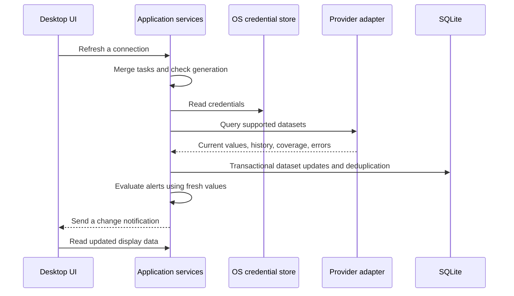

# QuotaVista Software Architecture

Version: 0.3

Date: 2026-10-18

Status: Architecture baseline, not implemented

License: MIT

QuotaVista is a local desktop application for Kimi shared membership quotas, OpenRouter prepaid balances, and daily, weekly, or custom-range consumption. A Rust backend handles core logic. The interface obtains display data through restricted local IPC, without a cloud server or local HTTP service.

This design implements the current [requirements draft](requirements.md) and defines technology choices, module boundaries, measurement semantics, and delivery gates. Token availability, Kimi authentication, and access to the actual shared quota remain subjects for later validation; the architecture does not establish a working integration.

All repository documentation, including diagrams and implementation guidance, is written in English for a global audience.

## Technology choices

| Component | Choice | Rationale |
| --- | --- | --- |
| Desktop container | Tauri 2 | System WebViews and desktop integration suit periodic queries and a persistent dashboard |
| Interface | React, TypeScript, Vite | Static frontend without server-side rendering or a separate Node.js runtime service |
| Backend | Rust, Tokio | Centralized collection, scheduling, aggregation, credentials, and desktop lifecycle |
| Database | SQLite accessed from Rust | Local persistence, transactions, migrations, and history without another service |
| Database access | SQLx with SQLite | Central backend queries and migrations; pin versions during application setup |
| HTTP | reqwest; system proxy behavior requires validation | Credentials stay in backend requests rather than frontend calls |
| Credentials | SecretStore abstraction and native stores | macOS Keychain and Linux Secret Service, with a future Windows implementation |
| Charts | Frontend chart component, selected during UI implementation | Render backend-generated series without independently recalculating accounting or time boundaries |
| Time and numbers | UTC instants, IANA zones, integer tokens, decimal amounts | Explicit source buckets and units, without floating-point accounting or duplicate counts |

Tauri supports Web frontends with Rust IPC and uses the system WebView rather than bundling a separate browser engine. [Official introduction](https://v2.tauri.app/start/)

The tradeoff is maintaining Rust and TypeScript and validating differences in WebViews, trays, and notifications across platforms. No installation-size, memory, or startup-time targets have been measured yet.

### Alternatives and reuse

| Option | Strength | Decision |
| --- | --- | --- |
| Electron | Consistent Chromium environment and mature JavaScript ecosystem | Fallback if the Tauri prototype fails target-platform requirements; the preferred stack avoids a separate Chromium and Node.js runtime |
| SwiftUI or AppKit | Direct native macOS integration | Not the main interface because it does not cover Linux |
| Browser and background service | Convenient access across machines | The first release does not need another deployment, port, or service lifecycle |
| Fork an existing tool | Existing UI, integrations, or authentication | Organize QuotaVista independently and evaluate individual components rather than inheriting unrelated chat, configuration switching, or proxy features |

See Electron's [process model](https://www.electronjs.org/docs/latest/tutorial/process-model) for its Chromium-based runtime.

OpenQuota, CodexBar, and CC Switch are reuse references. Their main-branch licenses were MIT when reviewed. Before copying any implementation, inspect the selected revision and file-level notices, retain attribution and license terms, and record provenance. No implementation code from these projects has been copied.

[OpenQuota license](https://github.com/deviffyy/OpenQuota/blob/main/LICENSE), [CodexBar license](https://github.com/steipete/CodexBar/blob/main/LICENSE), [CC Switch license](https://github.com/farion1231/cc-switch/blob/main/LICENSE)

## Modules and dependencies



| Module | Responsibility | Outside its responsibility |
| --- | --- | --- |
| Desktop UI | Display, interaction, accessibility, charts, navigation | Storing secrets, provider requests, provider accounting |
| Application services | Connections, queries, refresh, history synchronization, alerts | Interpreting provider-specific response fields |
| Domain rules | Measurement semantics, aggregation, validation | Tauri, HTTP, native credential APIs |
| Provider adapters | Authentication requirements, requests, parsing, capabilities, provenance | Rendering, database writes, notification delivery |
| Infrastructure | Persistence, secrets, HTTP, clocks, OS integration | Guessing token counts from subscription percentages |

The first release has one desktop application process plus its WebView interface. Tray availability and an explicit quit action determine background behavior after closing the main window. No separate system service continues collecting after application exit.

### Planned source layout

These directories describe the future application; they do not imply that code already exists.

```text
apps/desktop/
  src/                    React interface and IPC client
  src-tauri/              Tauri entry point, commands, permissions, OS integration
crates/core/
  src/domain/             Units, periods, coverage, error model
  src/application/        Use cases, sync, aggregation, alerts, abstract ports
crates/providers/
  src/kimi/               Kimi adapter
  src/openrouter/         OpenRouter adapter
  src/fixtures/           Synthetic provider responses
crates/infrastructure/
  src/storage/            SQLite and migrations
  src/secrets/            OS credential stores
  src/network/            HTTP client
docs/
  requirements.md
  architecture.md
  development-plan.md
```

A Cargo workspace manages Rust packages. Commit frontend and Rust lockfiles. These modules are responsibility boundaries, not separately deployed services. The core does not depend on providers or infrastructure; the desktop entry point assembles them. This permits later core reuse without committing to a first-release CLI.

## Provider adapter contract

Report supported, unsupported, permission_required, or unverified for each capability, with authorization category, source granularity, historical range, and reporting zone. Capabilities can vary by account and permissions; do not hard-code them solely by vendor.

| Capability | Result |
| --- | --- |
| Account identity | Provider scope, account or workspace identity, permission category |
| Current state | Plan, quota pools, wallets, key budgets, each with its own time and result |
| Historical consumption | Official events or time buckets with units, dimensions, and coverage |
| Pagination | Cursor, completion, truncation, and continuation information |
| Authentication check | Valid, invalid, insufficient permission, or indeterminate; no inference calls to probe balance |

Adapters receive in-memory credentials and query parameters and return structured data and typed errors. Application services own retry policy; parsers and the UI must not add independent polling loops.

### Initial providers

The Kimi adapter targets the shared membership pool. Its data source and authorization flow remain unvalidated, so initial development uses a clearly labeled simulated adapter. Before real access is verified, show Not connected rather than substituting independent Code limits or API credits.

OpenRouter account Credits, current-key budgets, and historical analytics are distinct capabilities. Use a Management Key only for required queries. With a regular key, retain supported information and mark missing account permissions. Do not count account and key representations of the same usage twice.

Research into tokens, history, and authentication remains scheduled for integration. This architecture does not assume that every provider returns exact tokens.

### Source identity and deduplication scope

A local connection_id identifies configuration, provider_scope_id identifies an account or workspace, and product_id identifies a plan, shared pool, or wallet. Keep these separate for future multi-account support.

Multiple keys for one account must not create duplicate account balances or histories. If the account scope cannot be identified reliably, do not combine connections and explain why. On plan upgrades, retain the old product's validity and quota period instead of interpreting past consumption with a new capacity.

## Data semantics

### Snapshots and consumption are separate

| Object | Meaning |
| --- | --- |
| AccountSnapshot | Plan, connection, and scope at a point in time |
| QuotaSnapshot | Remaining quota, percentage, and current period |
| WalletSnapshot | Balance, currency, and components such as cash or grants |
| UsageFact | An official consumption event or consumption in a complete official time bucket |
| CoverageInterval | Whether a metric and interval are complete, partial, missing, or unavailable |
| SyncCheckpoint | Pagination, progress, and revision state for a dataset and scope |

Snapshots can show change but do not automatically establish spending. UsageFact distinguishes official events, official buckets, and validated derivations. Unverified snapshot differences are observations, excluded from verified consumption.

### Units and numeric representation

- Tokens are nonnegative integers. Use sufficient integer range in Rust and check aggregation overflow. Serialize through IPC as decimal strings to avoid JavaScript integer precision loss.
- Monetary values use decimal arithmetic and an explicit currency. Store canonical decimal text in SQLite and aggregate with a decimal type in Rust; do not convert it to binary floating point for accounting in SQL or JavaScript.
- Normalize ratios as decimal values from zero to one; changes use percentage_points. Treat invalid source ranges as parsing errors rather than silently clamping.
- Adapters define whether cached and reasoning tokens are included in input or output. Do not add potentially overlapping subcounts before the relationship is established.
- Keep incompatible units, currencies, counting definitions, and bucket boundaries separate.
- Missing values carry explicit status and null values. Zero means a source-confirmed numerical zero.

### Time and coverage

Persist UTC instants plus the source zone, source bucket boundaries, and source reporting time. Query intervals are start-inclusive and end-exclusive. Return actual coverage and the reporting zone.

Use IANA rules for calendar-day and calendar-week boundaries, with Monday as the first day. A fixed 24-hour increment is not a valid calendar-day rule across daylight-saving changes. Do not split UTC-only source days into local calendar days.

Coverage is independent of request success. A successful HTTP request can return partial data. Mark an interval complete only when the source confirms completion, no truncation applies, and measurement semantics are compatible. An absence of records alone does not establish zero usage.

## Local persistence

SQLite lives in the OS application-data directory, outside the repository or a synchronization folder. Use single-instance protection, a serialized write queue, and bounded query connections. Database work must not block the UI thread.

Start with transactions and WAL, enable foreign keys, use a bounded busy timeout, and checkpoint periodically. WAL still has one concurrent writer and is unsuitable for network filesystems. Pin a SQLite version containing officially published WAL fixes and verify the linked version during setup. [SQLite WAL documentation](https://sqlite.org/wal.html)

| Table | Main fields and purpose |
| --- | --- |
| connections | id, provider, alias, credential_ref, enabled, generation, state, timestamps; no secret contents |
| provider_scopes | connection_id, scope_key, scope_type; account and workspace scope |
| products | scope_id, product_key, kind, validity, quota period or rule version |
| snapshots | product_id, metric, observed_at, source_as_of, unit, value, period |
| usage_facts | Dataset, scope, product, event or bucket identifier, dimensions, interval, metrics, source version |
| coverage_intervals | Dataset, metric, scope, start, end, granularity, zone, status, reason |
| sync_checkpoints | Connection, dataset, range, cursor, revision state |
| alert_states | Rule, scope, product, period, threshold state, last notification identifier |
| settings | Versioned local display and refresh settings |

UsageFact natural keys include dataset, scope, source event ID or bucket boundaries, and normalized dimensions. Repeated synchronization upserts values rather than adding to old values. Query planning selects one authoritative representation of overlapping usage instead of adding records from different sources.

Current values can commit independently. Historical cursors advance only in the transaction that persists their corresponding facts. Failure in one dataset does not delete last successful values or roll back another successful dataset.

Keep history for 90 days by default. Shrink coverage when facts are purged; do not claim complete history after deleting it. Retain latest snapshots, connection configuration, and alert state independently. Updating credentials preserves history; removing a connection deletes its local data.

Use monotonically versioned migrations. Before upgrades, create a consistent SQLite backup rather than copying only an active database file. On migration failure, preserve the original database and report recovery options. Backups contain sensitive usage data and must be handled when removing connections or clearing data; do not claim deletion while retaining that data in a backup.

## Query and refresh flow



- Allow one synchronization task per connection, initially with a global concurrency limit of two. Manual and scheduled refresh share tasks and provider rate limiters.
- Poll at one, five, or fifteen minutes, or disable polling. Schedule historical sync according to source latency and lookback capability; do not rescan 90 days on each balance refresh.
- Use bounded exponential backoff and jitter for timeouts, transient network failures, and appropriate server errors. Respect Retry-After. Invalid authentication stops affected queries until reconnection; insufficient permission disables only the affected capability.
- Disable, removal, or credential replacement cancels tasks and increments generation. Check generation before writes and discard outdated results so deleted connections cannot be recreated by a late response.
- Bound initial backfill by lookback limits and pagination. Resume using checkpoints and requery a recent revision window to capture late records.
- After wake or network recovery, perform one merged refresh and resume polling instead of replaying every missed timer.
- Change events carry affected scope or revision rather than requiring a full snapshot. The UI reloads state, and reopening the window always reads local state first.
- On quit, stop tasks and commit or roll back active writes. Without a tray, closing the main window exits the application rather than leaving an inaccessible process.

Connection health, freshness, and historical coverage are separate UI dimensions. A successful balance refresh does not establish current statistics, and restored cache does not imply a successful network request.

## Statistics and alerts

The statistics service accepts range, time zone, granularity, and account filters. It returns metric totals, daily or weekly series, plan and account breakdowns, coverage, and exclusion reasons.

Its pipeline is: construct half-open boundaries, select compatible sources and granularity, read facts, deduplicate and aggregate, calculate coverage, and return display objects with units. The frontend handles formatting and chart layout.

Keep shared quota periods separate and avoid adding percentage points across different capacities. Top-ups are not usage charges, and balance decreases are not bills. Exclude plans without tokens from token totals and name those exclusions while retaining their native quota statistics.

Evaluate alerts after fresh valid values commit, using persisted threshold state and stable period keys. Historical backfill and stale cache do not trigger new balance or quota alerts. Persist a notification identifier before calling the OS; accept a possible missed delivery in the narrow crash window rather than repeated restart notifications. In-app alert state remains available. Do not promise exactly-once OS notification delivery.

## Credentials and IPC boundaries

Credential inputs are limited to user-initiated connection creation and updates. Clear the original form value after submission. Queries and events must not return secrets, and secrets must not enter localStorage or SQLite. Return stable error codes, user-facing explanations, and retry guidance rather than complete response bodies or headers.

SecretStore hides platform differences. Use keyring-core with explicit macOS Keychain and Linux Secret Service stores, without automatic fallback to plaintext files. Pin compatible versions and ensure blocking store operations do not block the async runtime or UI.

[keyring-core](https://docs.rs/keyring-core/latest/keyring_core/), [macOS store](https://docs.rs/apple-native-keyring-store/latest/apple_native_keyring_store/), [Linux store](https://docs.rs/dbus-secret-service-keyring-store/latest/dbus_secret_service_keyring_store/)

If the Linux store is locked, prompt for unlocking. If it is unavailable, offer an explicit session-only option that retains credentials only in backend memory until exit and requires reconnection next time. Do not silently persist them. If system notifications are unavailable, retain in-app alerts and explain the limitation.

Connection creation is recoverable: generate a local identifier, save credentials, then commit nonsecret configuration; clean up new credentials after later failure. Removal first disables and cancels work, then deletes secrets and local data. Retain a deletion-pending state and retry if any step fails; do not report completion early.

Expose explicit commands only to trusted local application windows. Validate connections, settings, and ranges again in the backend. Do not expose arbitrary URL proxying, SQL, file paths, or shell commands. Include custom Tauri commands explicitly in permission configuration instead of assuming the framework's default isolation covers them. [Capabilities documentation](https://v2.tauri.app/security/capabilities/)

Built-in adapters constrain provider domains and must not forward credentials across domain redirects. Keep TLS verification enabled. Open consoles in the system browser. If Kimi ultimately requires another login window, review that trust boundary separately; remote pages must not inherit main-window IPC permissions.

Logging uses an allowlist: dataset, elapsed time, anonymous connection identifier, status code, and sanitized error category. Do not store raw requests or responses by default, prompts, model replies, or expose a credential-reading debug command.

## Platform validation and distribution

| Environment | Initial validation target | Status |
| --- | --- | --- |
| macOS | Development machine and architecture; window, Keychain, menu bar, notifications, wake | Requires application validation |
| Linux | Ubuntu 26.04, GNOME, x86_64; record the actual session type | Target confirmed, prototype and release validation pending |
| Other Linux desktops | Behavior without tray, notifications, or credential services | Include as environments become available |
| Windows | Keep domain rules and interfaces portable; add OS integration later | No first-release distribution |

Tauri's Linux tray events differ from other platforms, so core interactions remain in the main window. [Tray documentation](https://v2.tauri.app/learn/system-tray/)

Build packages on the corresponding native platform and validate installation, startup, upgrades, and removal. Initially evaluate DMG on macOS and deb on Linux; decide on AppImage after prototyping. Configure signing, notarization, and release secrets separately during release preparation, outside version control. [Distribution documentation](https://v2.tauri.app/distribute/)

Use manual upgrades for the first release without an update server. CI uses synthetic fixtures. Real-account validation happens locally; public workflows do not access user credentials.

## Delivery sequence and gates

See the [development plan](development-plan.md).

Prototype desktop and secure storage first, then validate actual provider data and authorization. Implement history, aggregation, and alerts before platform packaging. Demo adapters help develop UI and domain rules but cannot prove a real integration works.

If Tauri fails essential Linux requirements, document the failure and acceptable degradation before considering Electron. If a provider lacks a required metric, apply the coverage rules and expose the limitation. Explicitly revise requirements when P0 changes rather than silently lowering acceptance criteria.
