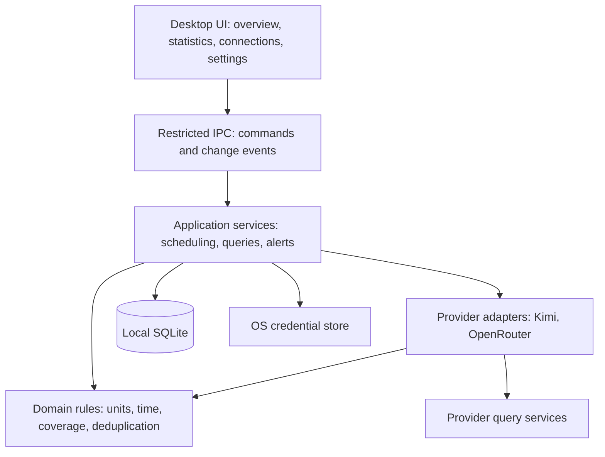
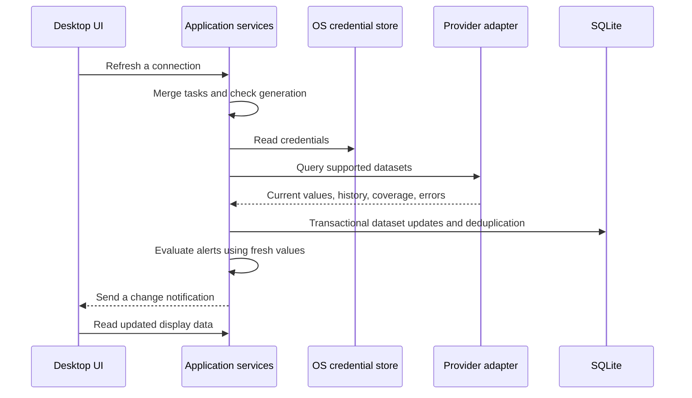

# QuotaVista Software Architecture

Version: 0.4

Date: 2026-10-18

Status: Internally reviewed design for prototype implementation; not runtime validated

License: MIT

QuotaVista is a local desktop application for Kimi shared membership quotas, OpenRouter prepaid balances, and daily, weekly, or custom-range consumption. A Rust backend handles core logic. The interface obtains display data through restricted local IPC, without a cloud server or local HTTP service.

This design implements the current [requirements draft](requirements.md) and defines technology choices, module boundaries, measurement semantics, and delivery gates. Token availability, Kimi authentication, and access to the actual shared quota remain subjects for later validation; the architecture does not establish a working integration.

All repository documentation, including diagrams and implementation guidance, is written in English for a global audience.

## Technology choices

| Component | Choice | Rationale |
| --- | --- | --- |
| Desktop container | Tauri 2 | System WebViews and desktop integration suit periodic queries and a persistent dashboard |
| Interface | React, TypeScript, Vite | Static frontend without server-side rendering or a separate Node.js runtime service |
| Backend | Rust, Tokio | Centralized collection, scheduling, aggregation, credentials, and desktop lifecycle |
| Database | SQLite accessed from Rust | Local persistence, transactions, migrations, and history without another service |
| Database access | SQLx with SQLite | Central backend queries and migrations; pin versions during application setup |
| HTTP | reqwest; system proxy behavior requires validation | Credentials stay in backend requests rather than frontend calls |
| Credentials | SecretStore abstraction and native stores | macOS Keychain and Linux Secret Service, with a future Windows implementation |
| Charts | Frontend chart component, selected during UI implementation | Render backend-generated series without independently recalculating accounting or time boundaries |
| Time and numbers | UTC instants, IANA zones, integer tokens, decimal amounts | Explicit source buckets and units, without floating-point accounting or duplicate counts |

Tauri supports Web frontends with Rust IPC and uses the system WebView rather than bundling a separate browser engine. [Official introduction](https://v2.tauri.app/start/)

The tradeoff is maintaining Rust and TypeScript and validating differences in WebViews, trays, and notifications across platforms. No installation-size, memory, or startup-time targets have been measured yet.

### Alternatives and reuse

| Option | Strength | Decision |
| --- | --- | --- |
| Electron | Consistent Chromium environment and mature JavaScript ecosystem | Fallback if the Tauri prototype fails target-platform requirements; the preferred stack avoids a separate Chromium and Node.js runtime |
| SwiftUI or AppKit | Direct native macOS integration | Not the main interface because it does not cover Linux |
| Browser and background service | Convenient access across machines | The first release does not need another deployment, port, or service lifecycle |
| Fork an existing tool | Existing UI, integrations, or authentication | Organize QuotaVista independently and evaluate individual components rather than inheriting unrelated chat, configuration switching, or proxy features |

See Electron's [process model](https://www.electronjs.org/docs/latest/tutorial/process-model) for its Chromium-based runtime.

OpenQuota, CodexBar, and CC Switch are reuse references. Their main-branch licenses were MIT when reviewed. Before copying any implementation, inspect the selected revision and file-level notices, retain attribution and license terms, and record provenance. No implementation code from these projects has been copied.

[OpenQuota license](https://github.com/deviffyy/OpenQuota/blob/main/LICENSE), [CodexBar license](https://github.com/steipete/CodexBar/blob/main/LICENSE), [CC Switch license](https://github.com/farion1231/cc-switch/blob/main/LICENSE)

## Modules and dependencies



| Module | Responsibility | Outside its responsibility |
| --- | --- | --- |
| Desktop UI | Display, interaction, accessibility, charts, navigation | Storing secrets, provider requests, provider accounting |
| Application services | Connections, queries, refresh, history synchronization, alerts | Interpreting provider-specific response fields |
| Domain rules | Measurement semantics, aggregation, validation | Tauri, HTTP, native credential APIs |
| Provider adapters | Authentication requirements, requests, parsing, capabilities, provenance | Rendering, database writes, notification delivery |
| Infrastructure | Persistence, secrets, HTTP, clocks, OS integration | Guessing token counts from subscription percentages |

The first release has one native application coordinator and the renderer processes managed by the platform WebView. Tray availability and an explicit quit action determine background behavior after closing the main window. No separate system service continues collecting after application exit.

### Planned source layout

These directories describe the future application; they do not imply that code already exists.

```text
apps/desktop/
  src/                    React interface and IPC client
  src-tauri/              Tauri entry point, commands, permissions, OS integration
crates/core/
  src/domain/             Units, periods, coverage, error model
  src/application/        Use cases, sync, aggregation, alerts, abstract ports
crates/providers/
  src/kimi/               Kimi adapter
  src/openrouter/         OpenRouter adapter
  src/fixtures/           Synthetic provider responses
crates/infrastructure/
  src/storage/            SQLite and migrations
  src/secrets/            OS credential stores
  src/network/            HTTP client
docs/
  requirements.md
  architecture.md
  development-plan.md
```

A Cargo workspace manages Rust packages. Commit frontend and Rust lockfiles. These modules are responsibility boundaries, not separately deployed services. The core does not depend on providers or infrastructure; the desktop entry point assembles them. This permits later core reuse without committing to a first-release CLI.

## Application contracts

These contracts specify the intended Rust and TypeScript boundary; they are not implemented APIs. Generate or mechanically check TypeScript contracts from the Rust transport types during setup. Keep domain types independent of serialization and map them explicitly at the IPC boundary.

| Command | Input | Result and side effects |
| --- | --- | --- |
| list_connections | None | Nonsecret connection summaries, lifecycle, per-dataset health, and capabilities |
| connect_provider | Provider enum, alias, credential kind, secret input, storage mode | Operation ID and pending setup state; validates using metadata queries only |
| update_connection | Connection ID, expected config revision, permitted metadata | Renames or changes settings without touching identity or alert episodes |
| replace_credentials | Connection ID, expected revision, candidate credential, storage mode | Candidate operation; keeps the active credential until scope verification and activation succeed |
| set_connection_enabled | Connection ID, expected revision, enabled flag | Serializes lifecycle change, cancels old tasks, and increments generation |
| remove_connection | Connection ID, expected revision, explicit deletion intent | Deletion operation with resumable status; never reports success before cleanup |
| refresh_connections | A bounded list of connection IDs or All | Job IDs; coalesces existing jobs and respects provider cooldowns |
| get_overview | Range, reporting zone, optional scope filter | Current values and range summary with independent freshness and coverage |
| query_statistics | Calendar dates, zone, day or week grain, scope filter | Totals, series, plan rows, exclusions, and effective source boundaries |
| update_settings | Expected settings revision and allowed changes | Persisted validated settings; no arbitrary file paths or URLs |
| get_operation | Operation or job ID | Sanitized progress, next action, and retry eligibility |

The IPC envelope contains contract_version, request_id, and either data or a stable error with code, retryable, retry_at, and a safe message. Secrets are accepted only by the two credential commands and never returned. Unknown providers, fields, IDs, revisions, dates, and enum values fail validation before any network or storage side effect. Use optimistic config revisions to reject stale UI mutations rather than overwriting a newer choice.

Change events contain only a monotonically increasing data_revision and affected local IDs. They are hints, not an event-sourced database. Subscribers load a consistent current view after an event; reconnecting or detecting a skipped revision triggers a full read. No secret is included in events, telemetry, or request identifiers.

### Metric and statistics transport

Every metric result includes metric_id, scope_id, product_id when applicable, unit, nullable value, availability, provenance, observed_at, nullable source_as_of, freshness, alert_eligible, and reason. A statistics result additionally includes requested_interval, effective_intervals, reporting_zone, grain, provisional, coverage, and excluded_scopes. Domain rules set alert_eligible only for a validated current-value query that is not explicitly an expired period, delayed history, or stale upstream response; collection time alone is insufficient proof.

Coverage distinguishes complete, partial, missing, and unsupported. Reasons include permission_required, not_yet_settled, outside_lookback, truncated, bucket_boundary_mismatch, collection_gap, and sync_pending. Query health is a separate field, so a failed refresh can coexist with a previously verified partition.

Decimal strings represent tokens, money, and ratios without floating-point conversion. The domain preserves exact numeric values; only display formatting may round. Token total is null, not zero, if no compatible input/output counts exist. An empty chart shows an empty-data explanation rather than an all-zero line.

The default display zone follows the user's setting. A UTC-only series is returned as a separate lane with its actual boundaries; the frontend must not align it under a local-day label or add it to an incompatible total. A selected reporting zone is never changed silently by an adapter.

### Interface states

Overview, Statistics, Connections, and Settings are the P0 screens. Each supports initial loading, usable cached data during refresh, no data, partial permission, and safe error recovery. Canceling a display query does not disable a connection or erase published facts. Navigation and filtering do not invoke credential validation or reset alerts.

UI copy is locale-keyed. Bundle complete en and zh-CN catalogs, use Simplified Chinese for an explicitly Simplified Chinese system locale on first launch and English otherwise, and persist the user's explicit preference. All design and contributor documentation remains English.

Add ui_locale to versioned settings and update it with the same optimistic revision check as other preferences. Switching catalogs re-renders the current screen without resetting range/account selection or contacting providers. Date and number formatters use the display locale while reporting boundaries continue to use the independently selected IANA zone. Alert records store a template key and safe parameters; render them in the current locale at display/dispatch time without creating a new episode. Known error codes, empty states, accessibility labels, and chart descriptions require both translations. Enforce key parity before release, with English as the runtime fallback.

## Provider adapter contract

Report supported, unsupported, permission_required, or unverified for each capability, with authorization category, source granularity, historical range, and reporting zone. Capabilities can vary by account and permissions; do not hard-code them solely by vendor.

| Capability | Result |
| --- | --- |
| Account identity | Provider scope, account or workspace identity, permission category |
| Current state | Plan, quota pools, wallets, key budgets, each with its own time and result |
| Historical consumption | Official events or time buckets with units, dimensions, and coverage |
| Pagination | Cursor, completion, truncation, and continuation information |
| Authentication check | Valid, invalid, insufficient permission, or indeterminate; no inference calls to probe balance |

Adapters receive in-memory credentials and query parameters and return structured data and typed errors. Application services own retry policy; parsers and the UI must not add independent polling loops.

### Initial providers

The Kimi adapter targets the shared membership pool. Its data source and authorization flow remain unvalidated, so initial development uses a clearly labeled simulated adapter. Before real access is verified, show Not connected rather than substituting independent Code limits or API credits.

OpenRouter account Credits, current-key budgets, and historical analytics are distinct capabilities. Use a Management Key only for required queries. With a regular key, retain supported information and mark missing account permissions. Do not count account and key representations of the same usage twice.

Research into tokens, history, and authentication remains scheduled for integration. This architecture does not assume that every provider returns exact tokens.

### Source identity and deduplication scope

A local connection_id identifies configuration, provider_scope_id identifies an account or workspace, and product_id identifies a plan, shared pool, or wallet. Keep these separate for future multi-account support.

Multiple keys for one account must not create duplicate account balances or histories. If the account scope cannot be identified reliably, do not combine connections and explain why. On plan upgrades, retain the old product's validity and quota period instead of interpreting past consumption with a new capacity.

Credential rotation preserves history only after the adapter proves the same provider account and workspace scope. A different or unverifiable identity cannot activate inside the old scope. Offer an explicit replacement connection: disable the old connection, preserve its history under its old identity until removal or retention, and activate the new scope. Default totals use the selected current scopes; archived accounts are never silently merged. P0 enforces one active connection per provider, including when candidate operations race.

## Data semantics

### Snapshots and consumption are separate

| Object | Meaning |
| --- | --- |
| AccountSnapshot | Plan, connection, and scope at a point in time |
| QuotaSnapshot | Remaining quota, percentage, and current period |
| WalletSnapshot | Balance, currency, and components such as cash or grants |
| UsageFact | An official consumption event or consumption in a complete official time bucket |
| CoverageInterval | Whether a metric and interval are complete, partial, missing, or unavailable |
| SyncCheckpoint | Pagination, progress, and revision state for a dataset and scope |

Snapshots can show change but do not automatically establish spending. UsageFact distinguishes official events, official buckets, and validated derivations. Unverified snapshot differences are observations, excluded from verified consumption.

### Units and numeric representation

- Tokens are nonnegative u64 values per source fact with checked u128 aggregate totals. Store canonical integer text and serialize through IPC as decimal strings to avoid SQLite signed-integer and JavaScript precision limits. Overflow fails the affected result.
- Monetary values use decimal arithmetic and an explicit currency. Initially support at most 28 significant digits and 18 fractional digits, with checked aggregate arithmetic. Store canonical decimal text in SQLite and aggregate with a decimal type in Rust; do not convert it to binary floating point for accounting in SQL or JavaScript. Unsupported precision is explicit and never silently rounded during ingestion.
- Normalize ratios as decimal values from zero to one; changes use percentage_points. Treat invalid source ranges as parsing errors rather than silently clamping.
- Adapters define whether cached and reasoning tokens are included in input or output. Do not add potentially overlapping subcounts before the relationship is established.
- Keep incompatible units, currencies, counting definitions, and bucket boundaries separate.
- Missing values carry explicit status and null values. Zero means a source-confirmed numerical zero.

### Time and coverage

Persist UTC instants plus the source zone, source bucket boundaries, and source reporting time. Query intervals are start-inclusive and end-exclusive. Return actual coverage and the reporting zone. Capture one as_of instant for a statistics request, clip open periods at that instant, and mark them provisional; future time after as_of is not missing coverage. The UI ignores completed display responses whose request ID no longer matches the current filters.

Use IANA rules for calendar-day and calendar-week boundaries, with Monday as the first day. A fixed 24-hour increment is not a valid calendar-day rule across daylight-saving changes. Do not split UTC-only source days into local calendar days.

Coverage is independent of request success. A successful HTTP request can return partial data. Mark an interval complete only when the source confirms completion, no truncation applies, and measurement semantics are compatible. An absence of records alone does not establish zero usage.

## Local persistence

SQLite lives in the OS application-data directory, outside the repository or a synchronization folder. Use single-instance protection, a serialized write queue, and bounded query connections. Database work must not block the UI thread.

Start with transactions and WAL, enable foreign keys, use a bounded busy timeout, and checkpoint periodically. WAL still has one concurrent writer and is unsuitable for network filesystems. Pin a SQLite version containing officially published WAL fixes and verify the linked version during setup. [SQLite WAL documentation](https://sqlite.org/wal.html)

| Table | Main fields and purpose |
| --- | --- |
| connections | id, provider, alias, credential_ref, enabled, generation, state, timestamps; no secret contents |
| provider_scopes | connection_id, scope_key, scope_type; account and workspace scope |
| products | scope_id, product_key, kind, validity, quota period or rule version |
| snapshots | product_id, metric, observed_at, source_as_of, unit, value, period |
| usage_facts | Dataset, scope, product, event or bucket identifier, dimensions, interval, metrics, source version |
| coverage_intervals | Dataset, metric, scope, start, end, granularity, zone, status, reason |
| sync_checkpoints | Connection, dataset, range, cursor, revision state |
| alert_states | Rule, scope, product, period, threshold state, last notification identifier |
| settings | Versioned local display and refresh settings |

For events, the unique fact key is scope, dataset, source event ID, and metric. Corrected event timestamps must update that key, not create a second event. For buckets, the key includes scope, dataset, source bucket boundaries, granularity, normalized dimensions, and metric. Use canonical non-null keys; a nullable source ID must not defeat SQLite uniqueness. Store revisions separately from identity. Repeated synchronization updates rather than adds to an existing contribution.

Current values can commit independently. Historical cursors advance only in the transaction that persists their corresponding facts. Failure in one dataset does not delete last successful values or roll back another successful dataset.

Keep history for 90 days by default. Shrink coverage when facts are purged; do not claim complete history after deleting it. Retain latest snapshots, connection configuration, and alert state independently. Same-scope credential rotation preserves history; a changed identity does not. Removing a connection deletes its local data and containing managed backups.

Use monotonically versioned migrations. Before upgrades, create a consistent SQLite backup rather than copying only an active database file. On migration failure, preserve the original database and report recovery options. Backups contain sensitive usage data and must be handled when removing connections or clearing data; do not claim deletion while retaining that data in a backup.

### Constraints and transaction boundaries

Add lifecycle_operations for durable setup, rotation, and deletion steps; sync_runs and staged_facts for candidate historical revisions; published_partitions for authoritative selection; and managed_backups for backup metadata. No table contains credential values or raw provider payloads. All child data references the local connection or scope with foreign keys and suitable cascade rules; required source dimensions use canonical strings rather than ambiguous null comparisons.

Index usage by scope, metric, and occurrence interval; snapshots by product, metric, and observation time; operations by lifecycle state. Enforce a partial uniqueness rule for one active connection per provider. Database migrations, backup/restore, and deletion use the same exclusive maintenance coordinator.

Every result write uses a short write transaction that checks both connection lifecycle and captured generation inside the transaction. If either changed, roll back without publishing data, updating freshness, advancing a checkpoint, or producing alerts. Checking generation only before opening the transaction is insufficient. Lifecycle mutations use the same writer, so either the result commits before the mutation or it is rejected after it. A per-connection mutation fence also blocks writes and dispatch while an external deletion or credential journal is pending; hold the coordinator's fence through commit. Recover these fences from external journals before opening connections after restart, including when the database projection was not committed. [SQLite transaction behavior](https://sqlite.org/lang_transaction.html)

A current-value commit contains the validated snapshot, its own success time, and a new data_revision. A historical page commit contains candidate rows and its candidate cursor. Final publication contains the complete replacement, coverage, published watermark, and a new data_revision. Emit UI invalidations only after commit. Roll back on write or commit failure; never turn an in-memory response into a successful persisted result.

### Historical replacement and source authority

Define a partition by provider scope, dataset, metric family, source interval, source grain, dimensions, and source authority. One source representation owns each requested metric interval: verified official events first where complete, otherwise a verified official bucket for the whole compatible interval. Never add overlapping event and bucket representations. Derived observations are a separate non-authoritative lane.

For a replacement run, stage pages under sync_run_id, generation, and a candidate revision. A cursor may advance only with its corresponding staged rows. Mark the candidate incomplete until the adapter proves the entire authoritative partition was retrieved without truncation or unsettled boundaries. Replace published rows and retire missing prior rows only within that verified partition, in one transaction.

An initial incomplete run can expose a separately labeled partial subtotal. It must never be added to a prior published subtotal for the same partition. During a replacement, keep the previous verified result visible with its original as-of time and a pending or failed-refresh indicator; the latest requested synchronization is not reported complete. Expired cursors or changed generations discard their candidate and restart a bounded run rather than guessing continuity.

Overlapping requery windows capture revisions, but the concrete window is set in each provider capability report during G02. Until then, do not hard-code a universal assumption that yesterday's records are final. Corrections outside a provider's lookback cannot be recovered automatically and must remain documented limitations.

### Retention and managed backups

Use UTC midnight 90 calendar days before the current UTC date as the retention cutoff. Keep an indivisible source bucket crossing that cutoff with its exact bounds; do not invent a split. Remove eligible facts and shrink coverage in one transaction. Latest-value snapshots, active lifecycle journals, and recovery checkpoints have separate retention policies.

Managed backups use SQLite's consistent backup API or a validated equivalent and an external manifest containing backup ID, schema version, creation time, and included opaque local scopes. Keep at most one pre-migration backup until the next successful launch after migration, unless a failed migration still needs recovery. Do not create a new backup during active deletion. [SQLite backup guidance](https://sqlite.org/backup.html)

Before connection deletion can be acknowledged, purge every managed backup containing that scope. A full-database backup is deleted as a whole; never claim that removing a row from the live database removed it from a backup. A minimal, atomically written deletion ledger outside the backed-up database records opaque local IDs and pending cleanup, without provider identifiers, secrets, or usage. Consult it before any managed restore or scheduling after recovery. Compact the ledger only when no managed backup can reintroduce those IDs and cleanup is complete.

Deletion failures remain visible and retryable. User-created copies and OS backups are outside this guarantee, and no physical-media forensic-erasure claim is made. SQLite files contain usage metadata without an application-level encryption guarantee; system credentials remain protected separately.

## Query and refresh flow



- Allow one synchronization task per connection, initially with a global concurrency limit of two. Manual and scheduled refresh share tasks and provider rate limiters. The per-connection coordinator serializes lifecycle mutations and task ownership; database generation checks provide the final protection against late writes.
- Poll at one, five, or fifteen minutes, or disable polling. Schedule historical sync according to source latency and lookback capability; do not rescan 90 days on each balance refresh.
- Use bounded exponential backoff and jitter for timeouts, transient network failures, and appropriate server errors. Respect Retry-After. Invalid authentication stops affected queries until reconnection; insufficient permission disables only the affected capability.
- Disable, removal, or credential replacement cancels tasks and increments generation. Check generation before writes and discard outdated results so deleted connections cannot be recreated by a late response.
- Bound initial backfill by lookback limits and pagination. Resume using checkpoints and requery a recent revision window to capture late records.
- With automatic refresh enabled, perform one merged refresh after wake or network recovery and resume polling instead of replaying every missed timer. With automatic refresh disabled, only an explicit user action may initiate a provider query.
- Change events carry affected scope or revision rather than requiring a full snapshot. The UI reloads state, and reopening the window always reads local state first.
- On quit, stop tasks and commit or roll back active writes. Without a tray, closing the main window exits the application rather than leaving an inaccessible process.

Connection health, freshness, and historical coverage are separate UI dimensions. A successful balance refresh does not establish current statistics, and restored cache does not imply a successful network request.

### Bounded work and error handling

These initial limits are implementation defaults to be measured during the prototype, not provider guarantees.

| Work | Bound | Outcome when reached |
| --- | --- | --- |
| Live query job | 10-second connection timeout, 30-second total job deadline including attempts and backoff, at most two retries for retryable metadata queries | Typed timeout or retry guidance; keep last committed values |
| Response body | 4 MiB after decompression, enforced while streaming | Invalid response with a bounded diagnostic; no partial parse advertised as valid |
| Historical job slice | At most 100 pages, 100,000 staged facts, or 30 seconds of active work, whichever comes first | Persist candidate progress and reschedule; coverage remains partial until complete |
| Local statistics | At most 366 selected calendar days, streaming aggregation, five-second cancellation deadline | Typed resource or validation error; retain the last display without relabeling it as current |
| Database lock | Bounded five-second busy timeout | Local storage error and retry; no successful sync timestamp |

A server Retry-After beyond the current job deadline is a persisted cooldown, not permission to retry early. Manual refresh respects it. Cancellation releases concurrency slots, and suspended connections do not occupy a slot. Repeated identical page cursors are an invalid-response error, not an infinite loop. Numeric overflow and unsupported decimal precision fail the affected metric rather than saturating or rounding silently.

Validate aliases as at most 80 Unicode code points after trimming surrounding whitespace. Preserve secret contents, bound secret input to 64 KiB, and reject line breaks for credentials destined for a single HTTP header. Provider authentication formats remain part of G01/G02; a size bound is not a claim that any submitted credential is valid. Install foreign-key and busy-timeout settings on every database connection, not only the first one in a pool.

Source cooldowns, candidate cursors, and lifecycle journals survive restart. Secrets in session-only memory do not. Timers use a monotonic clock while running; persisted instants remain UTC and clock anomalies must not produce negative ages or unbounded catch-up loops.

Use a typed error taxonomy shared with transport: validation, conflict, needs_credentials, authentication_required, permission_required, secret_store_locked, secret_store_unavailable, rate_limited, offline, timeout, invalid_response, resource_limit, storage_error, and cancelled. Keep capability-unavailable results separate from these errors. Network failures do not erase credentials or scope history. Long local aggregations check a cancellation token between bounded batches; dropping an async handle is not treated as cancellation of a blocking database or CPU operation.

Validate OS proxy discovery on both target systems. The HTTP client is created behind a factory so proxy changes can rebuild it while cancelling old-generation requests; TLS verification stays enabled. Never expose a generic frontend proxy command or include proxy authentication values in logs.

## Statistics and alerts

The statistics service accepts range, time zone, granularity, and account filters. It returns metric totals, daily or weekly series, plan and account breakdowns, coverage, and exclusion reasons.

Its pipeline is: construct half-open boundaries, select compatible sources and granularity, read facts, deduplicate and aggregate, calculate coverage, and return display objects with units. The frontend handles formatting and chart layout.

Keep shared quota periods separate and avoid adding percentage points across different capacities. Top-ups are not usage charges, and balance decreases are not bills. Exclude plans without tokens from token totals and name those exclusions while retaining their native quota statistics.

Evaluate alerts after fresh valid values commit, using persisted threshold state and stable period keys. Historical backfill and stale cache do not trigger new balance or quota alerts. Persist a notification identifier before calling the OS; accept a possible missed delivery in the narrow crash window rather than repeated restart notifications. In-app alert state remains available. Do not promise exactly-once OS notification delivery.

Persist rule_id, opaque scope, product, provider period key when available, episode sequence, last evaluated metric revision, and delivery state. Do not use a local calendar day as a substitute for the provider quota period. A first fresh low sample creates an episode; a later value strictly above the threshold rearms it. A source-confirmed new period also rearms it. When no period key exists, only observed recovery can rearm the threshold episode.

For the same sample, exhausted overrides low. Threshold edits and renames do not reset delivered episodes. Validate alert candidates against current connection generation, lifecycle, and rule state in the short claim transaction immediately before dispatch. A disable/delete action revokes unclaimed candidates; a notification already handed to the OS cannot be recalled reliably. No raw account identity appears in default notification text.

## Credentials and IPC boundaries

Credential inputs are limited to user-initiated connection creation and updates. Clear the original form value after submission. Queries and events must not return secrets, and secrets must not enter localStorage or SQLite. Return stable error codes, user-facing explanations, and retry guidance rather than complete response bodies or headers.

SecretStore hides platform differences. Use keyring-core with explicit macOS Keychain and Linux Secret Service stores, without automatic fallback to plaintext files. Pin compatible versions and ensure blocking store operations do not block the async runtime or UI.

[keyring-core](https://docs.rs/keyring-core/latest/keyring_core/), [macOS store](https://docs.rs/apple-native-keyring-store/latest/apple_native_keyring_store/), [Linux store](https://docs.rs/dbus-secret-service-keyring-store/latest/dbus_secret_service_keyring_store/)

If the Linux store is locked, prompt for unlocking. If it is unavailable, offer an explicit session-only option that retains credentials only in backend memory until exit and requires reconnection next time. Do not silently persist them. If system notifications are unavailable, retain in-app alerts and explain the limitation.

Connection creation and rotation use the durable lifecycle journal described below. Removal first disables and cancels work, then deletes secrets, local data, and containing managed backups. Retain a deletion-pending state and retry if any step fails; do not report completion early.

### Credential lifecycle and crash recovery

Native credential storage and SQLite do not share a transaction. Use versioned opaque credential references and a durable nonsecret operation journal; serialize store calls for a connection on a blocking worker. Journal the secret-reference lifecycle outside the database backup as well as its database projection, so managed restore cannot forget a newly created or superseded reference. Atomic journal updates contain only opaque references, operation IDs, and steps, never credential values. Reconcile this journal before restoring a backup or scheduling connections.

External journal and ledger writes use a same-directory temporary file, file flush/sync, atomic replacement, and directory synchronization where supported. If durability cannot be established, stop the lifecycle mutation before changing a secret or acknowledging deletion. Treat journal corruption as a visible recovery condition; do not infer that absent readable state means cleanup already finished.

1. Persist a pending setup or rotation operation and a candidate reference before writing a new persistent secret. Do not write a secret or active connection first and hope a later database commit succeeds.
2. Write the candidate to the selected native store, or keep it only in backend memory for an explicitly selected session-only operation. Validate metadata and scope using that candidate. Keep the old credential active during rotation.
3. In one database transaction, check expected generation/config revision, confirm matching scope, enforce the active-provider constraint, activate the new reference, and record cleanup of the previous reference. A mismatched identity follows the explicit separate-connection flow instead.
4. Delete superseded secrets and finish the journal step. On restart, resolve incomplete journal entries before scheduling: remove orphan candidates, retain the last committed reference, and resume cleanup idempotently. If the store is locked, show the pending action; do not declare success or downgrade storage silently.

For a session-only restart, persisted configuration has no retrievable secret reference and enters Needs credentials. Nonsecret setup intent may persist, but candidate values never enter the journal. A database failure during credential handling triggers compensation; failure of compensation remains a visible pending cleanup operation.

Deletion first writes the external deletion ledger and durably transitions lifecycle to Deletion pending with a generation increment. It then cancels work, deletes current and candidate secret references, purges managed backups, removes local facts/configuration, and finalizes the ledger only after all steps succeed. Before dispatch or restore, the ledger prevents scheduling for pending deleted IDs even if database recovery used an earlier backup.

Expose explicit commands only to trusted local application windows. Validate connections, settings, and ranges again in the backend. Do not expose arbitrary URL proxying, SQL, file paths, or shell commands. Include custom Tauri commands explicitly in permission configuration instead of assuming the framework's default isolation covers them. [Capabilities documentation](https://v2.tauri.app/security/capabilities/)

Built-in adapters constrain provider domains and must not forward credentials across domain redirects. Keep TLS verification enabled. Open consoles in the system browser. If Kimi ultimately requires another login window, review that trust boundary separately; remote pages must not inherit main-window IPC permissions.

Logging uses an allowlist: dataset, elapsed time, anonymous connection identifier, status code, and sanitized error category. Do not store raw requests or responses by default, prompts, model replies, or expose a credential-reading debug command.

## Platform validation and distribution

| Environment | Initial validation target | Status |
| --- | --- | --- |
| macOS | Development machine and architecture; window, Keychain, menu bar, notifications, wake | Requires application validation |
| Linux | Ubuntu 26.04, GNOME, x86_64; record the actual session type | Target confirmed, prototype and release validation pending |
| Other Linux desktops | Behavior without tray, notifications, or credential services | Include as environments become available |
| Windows | Keep domain rules and interfaces portable; add OS integration later | No first-release distribution |

Tauri's Linux tray events differ from other platforms, so core interactions remain in the main window. [Tray documentation](https://v2.tauri.app/learn/system-tray/)

Build packages on the corresponding native platform and validate installation, startup, upgrades, and removal. Initially evaluate DMG on macOS and deb on Linux; decide on AppImage after prototyping. Configure signing, notarization, and release secrets separately during release preparation, outside version control. [Distribution documentation](https://v2.tauri.app/distribute/)

Use manual upgrades for the first release without an update server. CI uses synthetic fixtures. Real-account validation happens locally; public workflows do not access user credentials.

The development host was observed as macOS 27.0.1 arm64 on 2026-10-18; this is an initial validation target, not the minimum supported macOS release. Record cold and warm prototype behavior plus the exact GNOME session type on Ubuntu 26.04 x86_64. A CI build for either system does not close G04 without native behavior evidence.

Keep credential and database work off the UI thread. Benchmark 90-day local queries over 100,000 synthetic facts, using five warm-up queries and at least 30 measured queries, with a target P95 of one second. Record the machine and query mix. The five-second query cancellation deadline is a failure bound, not the performance target. Prototype results may motivate an explicit budget revision; no measurements are claimed here.

## Delivery sequence and gates

See the [development plan](development-plan.md).

Prototype desktop and secure storage first, then validate actual provider data and authorization. Implement history, aggregation, and alerts before platform packaging. Demo adapters help develop UI and domain rules but cannot prove a real integration works.

If Tauri fails essential Linux requirements, document the failure and acceptable degradation before considering Electron. If a provider lacks a required metric, apply the coverage rules and expose the limitation. Explicitly revise requirements when P0 changes rather than silently lowering acceptance criteria.

## Design review and evidence

The [architecture review](reviews/architecture-review.md) records corrected design findings, recovery walkthroughs, and unresolved external gates. The [acceptance mapping](traceability.md) connects A01 through A25 to modules, failure cases, and expected evidence.

This design is ready for a bounded prototype after internal document review. No application build, performance benchmark, native credential test, or provider reconciliation has been executed. G01, G02, and G04 remain external gates; document checks cannot close them. G03's product decision is closed by the user's bilingual requirement, while A25 still requires runtime evidence.
